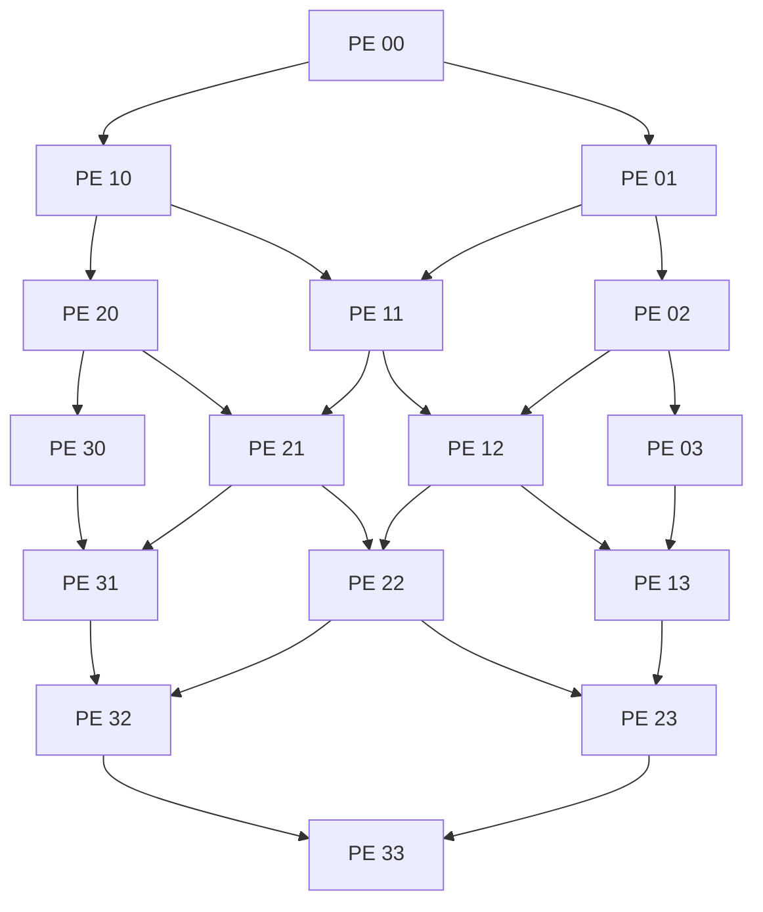

# 4×4 Systolic Array (Verilog)

A simple 4×4 output-stationary systolic array implemented in Verilog.

This project is for practicing RTL design and understanding how data moves between processing elements in a systolic array.

## Design

- 4×4 array with 16 processing elements (PEs)
- Signed 8-bit inputs and 32-bit accumulators
- Each PE performs multiplication and accumulation
- Input A moves horizontally, and input B moves vertically
- Reset, enable, and accumulator clear signals

## Architecture

- Horizontal: A data flow
- Vertical: B data flow

## Files

| File | Description |
|------|-------------|
| pe_os.v | Processing element |
| systolic_array_4x4.v | 4×4 array |
| tb_pe_os.v | PE testbench |
| tb_systolic_array_4x4.v | Array testbench |

## Verification

I used Vivado simulation to test the PE and the 4×4 array.

- PE: multiplication, accumulation, and accumulator reset
- Array: initial test using the output of PE(3,3)

The testbench currently checks only PE(3,3). Verification of all 16 outputs and complete matrix multiplication is still in progress.
